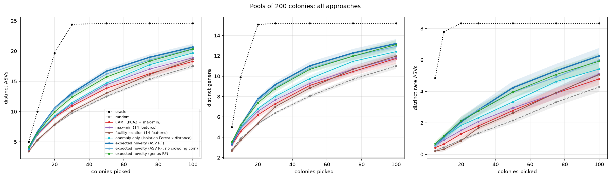
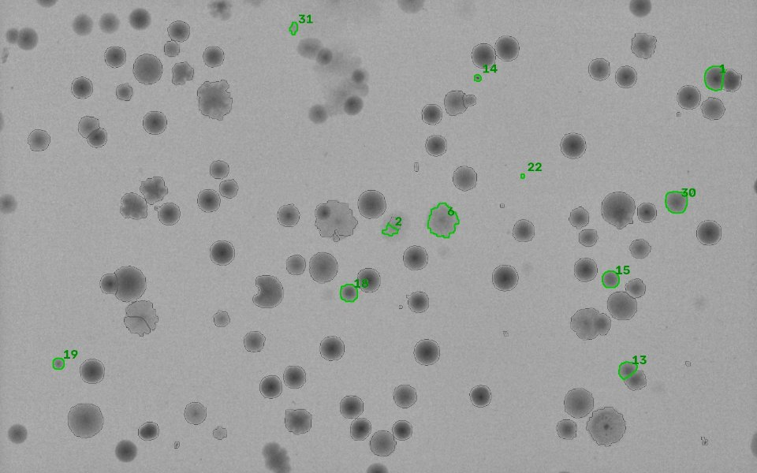
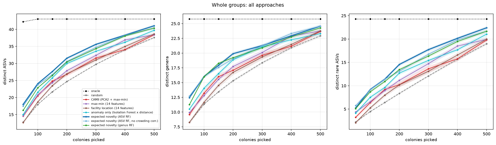
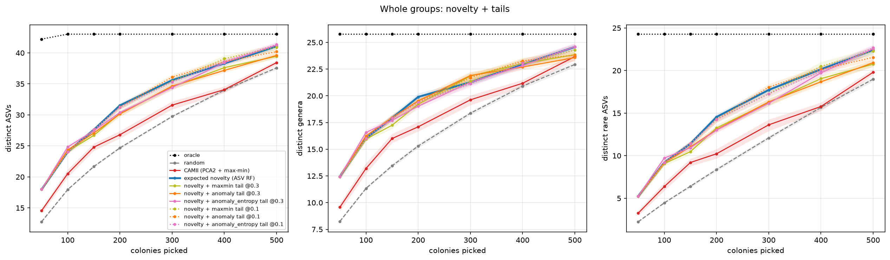
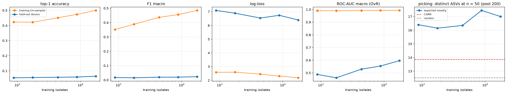

# colonypick — picking the most taxonomically diverse colonies from plate images

`colonypick` takes images of agar plates and chooses which colonies to pick so that the picked set
contains **as many different bacterial taxa as possible**. It builds on
[CAMII](https://github.com/hym0405/CAMII) (Culturomics by Automated Microbiome Imaging and
Isolation; Huang et al., *Nat Biotechnol* 2023): colony detection and the 14 morphological
features are a faithful port of CAMII. The picking strategy is new.

| | CAMII | colonypick |
|---|---|---|
| colony detection, 14 features | ✔ | same (ported, bit-identical on the CAMII example) |
| what "different" means | distance in a 2-D PCA of the features | probability of being a *different taxon* |
| selection | max-min spread in PCA space | greedy maximisation of the **expected number of distinct taxa** |
| knowledge from past runs | none | random forest trained on ~22,000 sequenced CAMII isolates |
| distinct ASVs among 50 picks (offline benchmark, pools of 200) | 13.9 | **16.7 (+20%)** |
| distinct genera among 50 picks | 9.1 | **11.0 (+21%)** |
| distinct rare ASVs among 50 picks | 2.8 | **4.2 (+52%)** |
| distinct ASVs among 300 picks (whole groups) | 31.6 | **35.6 (+13%)** |



## How it works

```
trans + epi plate images (BMP)
   │  1. detection (CAMII port): flat-field calibration, thresholding, contour filters,
   │     splitting of merged colonies, 14 features per colony
   ▼
colonies table (X, Y, Area, Perimeter, ..., colour statistics)
   │  2. classifier: random forest on log-size + shape + colour features + growth medium
   │     → p(colony belongs to taxon k), for ~135 ASVs (or ~80 genera) + "other"
   ▼
probability matrix P (colonies × taxa)
   │  3. expected-novelty selection, greedy:
   │        gain(i) = Σ_k  p_ik · Π_{j already picked} (1 − p_jk)
   │     pick the colony with the largest gain, update, repeat n times
   ▼
pick list (plate, colony, pixel coordinates, rank, predicted taxon) + annotated images
```

`gain(i)` is the expected number of taxa that colony *i* adds and that are not yet covered by the
colonies already picked. A colony that looks like an already-covered taxon gets a low gain even if
it is far away in feature space, and two colonies that look different but belong to the same
common taxon are not both picked. The catch-all "other" class (rare taxa) gets weight 0; giving it
weight was tested and did not help. Taxa you already have in a collection can be excluded so that
picks go to new ones (`--exclude-taxa`).

## Installation

With conda (recommended on Windows; use conda-forge only, so that you don't mix OpenMP runtimes):

```bash
git clone https://github.com/<you>/colonypick.git
cd colonypick
conda env create -f environment.yml
conda activate colonypick
pip install -e . --no-deps
colonypick --help
```

With pip only: `pip install -e .`

## Quick start

### 1. Train the classifier (once)

The model is trained on the public CAMII isolate tables (not included in this repository; they are
released with Huang et al. 2023, see the CAMII repository/paper for the download):

* `CAMII_isolates_metadata.tsv`
* `CAMII_isolates_morphological_features.tsv`
* `CAMII_isolates_16SV4_result.tsv`
* optional: the folder of all detected colonies (`colony_all.metadata.<date>/`, one CSV per
  plate), which enables the plate-crowding correction of the size features.

```bash
colonypick train \
    --metadata   CAMII_isolates_metadata.tsv \
    --morphology CAMII_isolates_morphological_features.tsv \
    --s16        CAMII_isolates_16SV4_result.tsv \
    --colonies   colony_all.metadata.20220714 \
    --level asv \
    --out models/colonypick_asv.joblib
```

This takes a few minutes and writes `colonypick_asv.joblib` (~70 MB on disk, ~0.5 GB in memory) and
`colonypick_asv.json` (training summary and, for every ASV class, its genus and V4 sequence).
`--level genus` trains a genus-level model instead.

### 2. Pick colonies from images

Put the image pairs in one folder, named as by the CAMII imaging station:
`<barcode>_<timestamp>.bmp`. For each plate the earlier image is trans-illuminated and the later
one epi-illuminated.

```bash
colonypick pick \
    --images      plates/ \
    --calibration calib_parameter.npz \
    --model       models/colonypick_asv.joblib \
    --n 96 --media mGAM \
    --out picks/
```

All plates in the folder form one picking group, and the `n` colonies are chosen jointly across
them. That suits a few plates of one sample.

#### Many plates: batches

For a large folder (e.g. hundreds of plates from many samples), plates are processed **in batches**,
one picking group at a time. Each batch is detected, picked and written to disk before the next one
starts, so memory use stays small. Detection results are cached in `<out>/cache`, so an interrupted
run continues where it stopped, and re-running with another `--n` skips detection.

Batches come from a CAMII-style sample sheet. `colonypick sheet` writes one for the CAMII images,
grouping plates by sample and medium from the isolate metadata:

```bash
colonypick sheet --images plates/ --metadata CAMII_isolates_metadata.tsv --out sample_sheet.csv
colonypick pick  --images plates/ --calibration calib_parameter.npz \
    --model models/colonypick_asv.joblib --sample-sheet sample_sheet.csv --compare-camii --out picks/
```

By default `numGroupPick` is the number of colonies CAMII actually picked from that group, which
gives a like-for-like comparison. `--n 96` sets the same number for every group. Plates missing from
the metadata get `groupID = unassigned` and `numGroupPick = 0` (skipped). You can edit the sheet, or
write your own (see `examples/sample_metadata.csv`):

| column | meaning |
|---|---|
| `barcode` | plate barcode (image file prefix) |
| `groupID` | plates picked jointly (one batch) |
| `numGroupPick` | colonies to pick in the group (0 = skip) |
| `plateType` (or `media`) | growth medium, e.g. `mGAM` |

Without a sample sheet, `--batch-size 5 --n 30` picks 30 colonies from each block of 5 plates
(plates sorted by barcode).

Options:

* `--exclude-taxa known.txt`: taxa already in your collection, one per line, given as a model class
  (`ASV8`), the label printed in `picks.csv` (`ASV8 (Bacteroides)`), a genus name (excludes all its
  ASVs) or an exact V4 sequence.
* `--compare-camii`: also writes the picks of the original CAMII algorithm.
* `--tail {none,maxmin,anomaly,anomaly_entropy}` (experimental, default `none`): for large pick
  numbers. Once a pick adds fewer than `--switch-gain` (default 0.1) expected new taxa, the remaining
  picks are filled by morphology: farthest from the colonies already picked (`maxmin`), or Isolation
  Forest anomaly rank × that distance (`anomaly`), optionally × classifier entropy
  (`anomaly_entropy`). The column `pick_phase` in `picks.csv` shows which phase chose each colony.
  See *Large pick numbers* below before using it.
* `--config`: a CAMII `configure` file with detection parameters (default: the published CAMII
  values, also in `configs/camii_detection.cfg`).

### Outputs

| file | content |
|---|---|
| `picks.csv` | all picks: group, pick_rank, plate_barcode, colony_index, X/Y (cropped image), X_rawImage/Y_rawImage (raw image pixels), 14 features, predicted_taxon, predicted_prob, expected_new_taxa, expected_taxa_cumulative |
| `<group>_picks.csv`, `<group>_colonies.csv` | picks and all detected colonies (with predictions) of one group |
| `camii_picks.csv`, `<group>_camii_picks.csv` | original CAMII picks (with `--compare-camii`) |
| `plates/<barcode>_picks.csv` | compact pick list of one plate |
| `plates/<barcode>_picks.jpg` | trans image: all colonies outlined in grey, picks in green with their rank |
| `cache/` | detection results (safe to delete) |



`pick_rank` is the order of choice. If you can pick fewer colonies than planned, take the top ranks;
the greedy order makes every prefix a good set. `expected_new_taxa` comes from the classifier's
probabilities and is an optimistic, model-based estimate. Use it to rank colonies, not as a
prediction of the number of taxa you will get.

**Coordinates** are pixels of the raw image (`X_rawImage`, `Y_rawImage`) and of the cropped image
(`X`, `Y`). Converting them to robot coordinates (CAMII fits a per-instrument offset model) is
specific to your picker and is not included.

### Other commands

```bash
colonypick detect    --images plates/ --calibration calib_parameter.npz --out detection/   # colonies + features only
colonypick calibrate --images blank_plates/ --out calib_parameter.npz                       # flat-field calibration
colonypick benchmark --metadata ... --morphology ... --s16 ... --out benchmark/             # full evaluation (report.html)
```

**Calibration.** CAMII corrects uneven illumination with images of blank plates. Build the file once
per imaging setup with `colonypick calibrate`, using a folder of blank-plate image pairs. Without
calibration, detection still works, but the colour/brightness features are on a different scale
than the training data, so predictions get worse.

## Evaluation

### Protocol

Only randomly picked isolates are an unbiased sample of what grows on a plate, so strategies are
compared inside candidate pools drawn from them. The CAMII data contain four sample × medium groups
with random picks (H1t1, H1t4, H5t1, H6t1, all on mGAM; three donors; 599–865 random picks each).
Two scales are simulated:

* **pools of 200**: 20 random pools of 200 colonies per group, up to 100 picks;
* **whole groups**: 10 random 90% subsamples of each group (539–778 colonies), up to 500 picks.

Each strategy picks from the same pools; we count distinct 16S V4 ASVs (1-mismatch denoising,
purity ≥ 50%), distinct genera and distinct **rare** ASVs (≤ 2 isolates in the group). Classifier
probabilities are **out-of-fold with folds grouped by donor**, so every pool is scored by a model that
never saw that donor. Intervals are 95% bootstrap intervals over pools (stratified by group). With only
four groups (three donors) they understate between-sample uncertainty, so the number of groups won is
reported as well.

Everything below is produced by one command, which writes `report.html`, CSV tables and figures:

```bash
colonypick benchmark --metadata ... --morphology ... --s16 ... --colonies ... --out benchmark/
```

It takes ~20 minutes on a laptop (`--quick`: a few minutes, indicative only). The older commands
`evaluate` (pools of 200, fewer strategies) and `evaluate-tail` (large pick numbers) are kept.

### Result: expected novelty is the winner

Area under the picking curve divided by the oracle's (1.0 = every pick a new taxon as long as
possible), distinct ASVs:

| strategy | pools of 200 | Δ vs CAMII [95% CI] | groups > CAMII | whole groups | Δ vs CAMII [95% CI] |
|---|---|---|---|---|---|
| **expected novelty (ASV RF, crowding correction)** | **0.691** | **+0.094 [+0.080, +0.107]** | **4/4** | **0.761** | **+0.083 [+0.075, +0.092]** |
| expected novelty (ASV RF, no crowding correction) | 0.679 | +0.081 [+0.068, +0.093] | 3/4 | 0.748 | +0.071 [+0.062, +0.079] |
| expected novelty (genus RF) | 0.663 | +0.066 [+0.053, +0.078] | 3/4 | 0.738 | +0.061 [+0.051, +0.070] |
| anomaly only (Isolation Forest × distance) | 0.635 | +0.037 [+0.025, +0.049] | 3/4 | 0.718 | +0.040 [+0.031, +0.049] |
| max-min on the 14 features | 0.619 | +0.021 [+0.008, +0.033] | 3/4 | 0.699 | +0.022 [+0.013, +0.030] |
| **CAMII (PCA2 + max-min)** | 0.597 | – | – | 0.678 | – |
| facility location on the 14 features | 0.573 | −0.024 [−0.038, −0.011] | 2/4 | 0.669 | −0.008 [−0.017, +0.001] |
| random | 0.551 | −0.046 [−0.058, −0.036] | 2/4 | 0.644 | −0.034 [−0.041, −0.026] |

Mean distinct taxa at selected pick numbers (pools of 200; ASVs / genera / rare ASVs):

| strategy | n = 20 | n = 50 | n = 100 |
|---|---|---|---|
| random | 7.8 / 5.3 / 0.9 | 12.5 / 8.0 / 2.2 | 17.5 / 11.0 / 4.3 |
| CAMII | 9.1 / 6.2 / 1.3 | 13.9 / 9.1 / 2.8 | 18.3 / 11.7 / 4.8 |
| **expected novelty** | **10.6 / 7.8 / 2.1** | **16.7 / 11.0 / 4.2** | **20.7 / 13.2 / 6.3** |
| oracle | 19.7 / 15.1 / 8.3 | 24.6 / 15.2 / 8.3 | 24.6 / 15.2 / 8.3 |

* **Expected novelty beats CAMII in all six comparisons** (3 metrics × 2 scales), with intervals
  excluding zero, in 4/4 groups for pools of 200 and 3/4 for whole groups. At n = 50 it finds +20%
  ASVs, +21% genera and **+52% rare ASVs**. The relative gain is largest for rare taxa.
* **The ASV-level classifier is the best choice, even for genus diversity** (genus AUC 0.718 vs
  0.701 for the genus classifier). Finer classes carry more information about what differs.
* **Crowding correction helps a little and consistently** (+0.012 AUC for ASVs, +0.023 for rare
  ASVs at whole-group scale; 4/4 vs 3/4 groups). Train with `--colonies` when the table is available.
* **Facility location is worse than CAMII.** It maximises coverage, so it picks *typical* colonies,
  the opposite of what diversity needs.
* **Per group** (ASVs at n = 50, pools of 200): H1t1 18.5 vs 14.6 (CAMII), H1t4 21.4 vs 16.7, H5t1
  14.9 vs 13.2, H6t1 12.1 vs 11.0. Large pick numbers (n = 300, whole groups): H1t1 40.9 vs 30.3,
  H1t4 48.6 vs 41.8, H5t1 26.4 vs 25.6, **H6t1 26.5 vs 28.6**: the only group where CAMII is ahead.



### Large pick numbers: tails and anomaly detection do not help

The classifier distinguishes ~135 taxa, so when hundreds of colonies are picked the expected gain per
pick falls towards zero. Rare taxa (merged into "other") are what remains to be found. Two ideas were
tested: switching from expected novelty to a morphology "tail" once a pick adds < 0.3 or < 0.1
expected new taxa (max-min, Isolation Forest anomaly × distance, anomaly × classifier entropy), and
anomaly detection alone.

* All six novelty + tail variants are **statistically tied with plain expected novelty** (|Δ AUC| ≤
  0.003, intervals including zero, leader changes between metrics). Switching early (0.3) costs up to
  1.5 taxa between 150 and 400 picks.
* Even with tiny expected gains, the novelty order keeps preferring colonies unlike those already
  picked: at 500 picks it still finds 2.6 more rare ASVs than CAMII.
* **Anomaly detectors as rare-taxon detectors** (target: ASVs with ≤ 2 isolates in the group, base
  rate 4.5%):

  | detector | ROC-AUC | PR-AUC | precision@10% | recall@10% | F1@10% |
  |---|---|---|---|---|---|
  | Isolation Forest | 0.641 | 0.104 | 0.110 | 0.237 | 0.149 |
  | classifier entropy | 0.627 | 0.078 | 0.078 | 0.163 | 0.105 |
  | LOF (k = 20) | 0.599 | 0.072 | 0.077 | 0.159 | 0.103 |
  | kNN distance (k = 10) | 0.594 | 0.084 | 0.074 | 0.153 | 0.099 |
  | classifier p(other) | 0.585 | 0.108 | 0.103 | 0.223 | 0.140 |

  Rare taxa are somewhat unusual-looking (Isolation Forest roughly doubles their share among
  flagged colonies), which is why "anomaly only" beats CAMII. But the classifier already captures
  this, so as a tail it adds nothing. In H6t1 every detector is at chance (ROC-AUC 0.45–0.56).

The tails remain available as `pick --tail ...` (experimental); the default is `none`.



### Classifiers

Out-of-fold on held-out donors; 135 ASV classes (or 81 genera) with ≥ 10 isolates, plus "other":

| classifier | top-1 acc. | top-5 acc. | balanced acc. | F1 macro | F1 weighted | log-loss | Brier | ROC-AUC macro / weighted | PR-AUC macro | ECE |
|---|---|---|---|---|---|---|---|---|---|---|
| ASV RF, crowding corr. | 0.065 | 0.227 | 0.031 | 0.023 | 0.070 | 6.40 | 0.992 | 0.596 / 0.681 | 0.022 | 0.086 |
| ASV RF, no correction | 0.064 | 0.228 | 0.031 | 0.023 | 0.069 | 6.35 | 0.992 | 0.584 / 0.679 | 0.022 | 0.086 |
| genus RF | 0.187 | 0.441 | 0.050 | 0.039 | 0.238 | 4.33 | 0.920 | 0.615 / 0.691 | 0.033 | 0.024 |

As **taxon identifiers** the classifiers are weak. Top-1 accuracy is below the majority-class rate
(0.115 for ASVs, 0.290 for genera) because training uses balanced class weights. The ASV log-loss
(6.40) is worse than a uniform guess over 136 classes (ln 136 = 4.91), i.e. the probabilities are
overconfident on new donors. Recalibration was tested earlier and did not improve picking. Their
**ranking** is informative, though (weighted ROC-AUC 0.68), and
that is what expected novelty uses: it only needs to know which colonies are likely the *same* taxon
as ones already picked.

### Representations: are two colonies the same taxon?

ROC-AUC over random colony pairs within a group (0.5 = no information):

| representation | same ASV | same genus | H1t1 | H1t4 | H5t1 | H6t1 |
|---|---|---|---|---|---|---|
| CAMII: PCA2 of z-scored features | 0.607 | 0.581 | 0.610 | 0.677 | 0.584 | 0.505 |
| 14 features (log, z-scored) | 0.606 | 0.587 | 0.622 | 0.676 | 0.585 | 0.504 |
| 14 features + crowding correction | 0.607 | 0.588 | 0.622 | 0.678 | 0.586 | 0.504 |
| classifier probabilities (ASV RF) | 0.619 | 0.598 | 0.605 | 0.738 | 0.579 | 0.511 |
| classifier probabilities (genus RF) | 0.613 | 0.597 | 0.595 | 0.734 | 0.583 | 0.509 |

Pairwise similarity alone separates taxa only modestly, and **in H6t1 no representation carries
any taxonomic signal** (all ≈ 0.50). This explains why every method, including ours, is close to
random there: in that sample, colony morphology does not distinguish taxa. The gain of expected
novelty comes less from a better distance than from the greedy coverage objective, which uses the
classifier's knowledge of how *common* each look-alike taxon is.

### Learning curves

The ASV classifier trained on 5–100% of each fold's training isolates (877–17,549):

| training isolates | 877 | 1,755 | 4,387 | 8,775 | 17,549 |
|---|---|---|---|---|---|
| top-1 accuracy, training / held-out | 0.42 / 0.054 | 0.42 / 0.056 | 0.45 / 0.058 | 0.47 / 0.060 | 0.50 / 0.065 |
| F1 macro, training / held-out | 0.35 / 0.017 | 0.39 / 0.015 | 0.44 / 0.020 | 0.46 / 0.020 | 0.48 / 0.023 |
| log-loss, training / held-out | 2.58 / 7.10 | 2.59 / 6.89 | 2.45 / 6.54 | 2.31 / 6.74 | 2.18 / 6.40 |
| ROC-AUC macro, held-out | 0.49 | 0.46 | 0.53 | 0.55 | 0.60 |
| picking: distinct ASVs at n = 50 | 16.4 | 16.2 | 16.4 | 17.5 | 17.0 |



* **Large gap between training and held-out donors.** The model fits its training donors (top-1
  0.50) but transfers poorly to new donors (0.065). Colony appearance of the same taxon varies between
  samples.
* **Held-out ROC-AUC is still rising at the full data set** (0.49 → 0.60), so more labelled isolates,
  especially from *more donors*, would still improve the classifier.
* **Picking quality is nearly flat** (16.2–17.5, within the noise of this sub-benchmark, which uses
  5 pools per group). Even ~900 training isolates give most of the gain over CAMII (13.9). The coverage
  objective makes good use of weak probabilities.

### What was tried and did not help

The full experiment script is in `experiments/camii_picking_eval.py`. None of these beat the random
forest on the 14 CAMII features within the noise of the benchmark:

* DINOv2 image embeddings of colony crops (with or without per-plate contrast normalisation);
* a CNN trained on colony crops (+0.4 genera at n = 50, within noise);
* other representations for distance-based picking: all 14 features (raw or log-scaled), facility
  location instead of max-min, classifier-probability similarity;
* adaptive rounds (re-weighting after "sequencing" earlier picks), rarity bonuses, probability
  calibration, hybrid novelty + distance scores, hierarchical genus → ASV objectives;
* a positive weight for the "other" (rare taxa) class;
* for large pick numbers, an Isolation Forest / LOF anomaly or max-min tail after expected novelty.

## Limitations

* **Few independent test samples.** Only three donors (four groups) have random picks, so the
  benchmark has wide uncertainty. In one group (H6t1) colony morphology carries no taxonomic signal
  (pairwise AUC ≈ 0.50 for every representation); there no method is much better than random, and at
  large pick numbers CAMII is slightly ahead.
* **Weak, overconfident classifier on new donors** (top-1 6.5%, log-loss above uniform). It works for
  ranking picks, but its `predicted_taxon` / `predicted_prob` are not reliable identifications.
* **Trained on CAMII data.** The model has learned CAMII's imaging hardware, media (mostly mGAM) and
  human gut communities. Other imaging setups, media or sample types need recalibration and,
  ideally, retraining on your own sequenced isolates (same table format).
* **ASV labels are dataset-specific.** `ASV8` is the 8th most common V4 sequence in the training
  data; its sequence and genus are stored in the model's `.json` file.
* Classes with fewer than 10 isolates are merged into "other", so the model cannot target very rare
  taxa directly.
* No robot coordinate transformation (see *Coordinates*).

## Repository layout

```
colonypick/
  detection.py   CAMII colony detection and features (port)
  data.py        loading and labelling of the CAMII isolate tables
  features.py    classifier features, plate-context correction
  model.py       random forest taxon classifier (train / predict / save)
  picking.py     expected-novelty selection, original CAMII max-min
  pipeline.py    images → picks
  evaluate.py    offline benchmarks (pools of 200; large pick numbers)
  benchmark.py   full benchmark of every approach -> report.html
  cli.py         command line
configs/         CAMII detection parameters
examples/        sample sheet example
experiments/     full experiment script used during development
tests/           smoke tests on synthetic data (python -m pytest tests)
```

## Citation

If you use this code, please cite CAMII, which provides the detection method and the training data:

> Huang Y, Sheth RU, Zhao S, et al. High-throughput microbial culturomics using automation and
> machine learning. *Nature Biotechnology* 41, 1424–1433 (2023). https://doi.org/10.1038/s41587-023-01674-2

## License

MIT, see `LICENSE`. The colony detection is ported from CAMII (MIT, © 2021 Yiming Huang).
